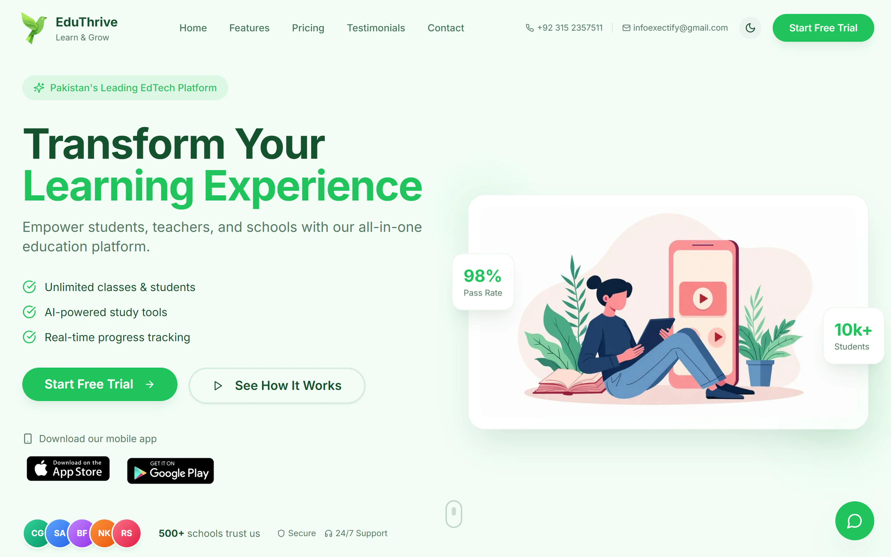

# The Learning Hub

**An online learning experience with progress tracking, quizzes and video lessons.**

    

## Overview

A learning management platform that connects course delivery with a student’s learning journey. Its interface brings video lessons, interactive quizzes and real-time progress tracking together in a React and Node.js application.

## The challenge

Learning resources were scattered, with no central place for courses, quizzes and progress.

## The solution

A unified platform for delivering high-quality educational content and following each student’s progress.

## Key features

- Real-time progress tracking
- Interactive quizzes
- Video learning

## Tech stack

React · Node.js · Express

## Live

https://thelearninghub.vercel.app/

## Privacy

Client names and records are confidential. Every screen in this repository uses sample data, and source code that belongs to the client is not published.

## Links

- Case study on Lexvaxa: https://lexvaxa.com/work/learning-hub
- Built by **Ch Muhammad Samiullah** ([GitHub](https://github.com/samiullah156-creator)) at [Lexvaxa](https://lexvaxa.com)
